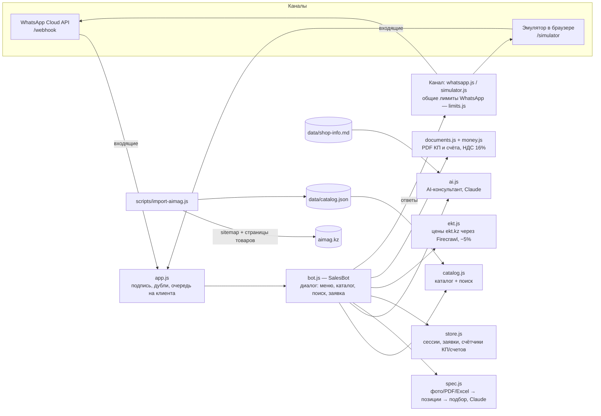

# Архитектура бота

## Слои

| Слой | Файлы | Ответственность |
|---|---|---|
| Каналы | `src/channels/*` | Отправка `text` / `buttons` / `list` / `document`. Единый интерфейс; лимиты WhatsApp (3 кнопки, 10 строк, длины) в `limits.js` применяются во всех каналах |
| Приложение | `src/app.js` | HTTP-маршруты, проверка подписи Meta, отсев повторных доставок, последовательная обработка сообщений одного клиента, доступ по `ADMIN_TOKEN` |
| Диалог | `src/bot.js` | Конечный автомат: `idle → qty → checkout_name → checkout_city → checkout_comment → checkout_confirm`, плюс `manager` (бот молчит). Не знает про HTTP и канал |
| Каталог | `src/catalog.js` | Загрузка `catalog.json`, нормализация (`3х2,5` = `3x2.5`), поиск: все слова → точное совпадение, иначе большинство слов |
| AI | `src/ai.js` | Отвечает на свободный текст. Получает информацию о компании и до 15 найденных под вопрос позиций (не весь каталог) |
| Спецификации | `src/spec.js` | Claude читает фото/PDF/Excel → позиции; кандидаты из поиска → Claude выбирает товар (exact/analog/none) |
| Цены поставщика | `src/ekt.js` | Нет в каталоге → поиск на ekt.kz, цена клиенту = цена сайта × 0.95, проверка минимальной прибыли |
| Документы | `src/documents.js`, `src/money.js` | PDF КП и счёта по образцу AIMAG, НДС 16% «в том числе», сумма прописью |
| Данные | `src/store.js` | Сессии клиентов и заявки в JSON-файле. Интерфейс простой — заменяется на PostgreSQL/Redis без изменения бота |

## Поток сообщения

1. Meta присылает POST `/webhook` → проверка `X-Hub-Signature-256` → сразу `200`.
2. Сообщения разбираются (`webhook.js`), дубли по `message.id` отбрасываются.
3. Сообщения клиента ставятся в его очередь (порядок важен: «добавить» → «количество»).
4. `SalesBot.handle` по `replyId` (нажатие кнопки/строки) или тексту выбирает действие, меняет сессию, отвечает через канал.
5. Фото/PDF/Excel: пауза, чтобы собрать все фото → разбор → подбор → найденные в заявку, остальные «уточним у поставщиков».
6. Свободный текст: поиск по каталогу → (если включён) ответ AI → список найденных товаров с кнопками.
7. Заявка сохраняется → КП в PDF клиенту и менеджеру (низкая прибыль — сначала «ок <номер>» от менеджера)
   → «Согласен» → реквизиты покупателя → счёт в PDF.

## Идентификаторы кнопок

| id | Действие |
|---|---|
| `menu`, `catalog`, `cart`, `manager`, `search` | Главные разделы |
| `cats:<offset>` | Страница списка разделов |
| `cat:<раздел>:<offset>` | Товары раздела, страница |
| `found:<offset>` | Страница результатов поиска |
| `prod:<id>` | Карточка товара |
| `add:<id>` | В заявку → спросить количество |
| `checkout`, `no_comment`, `confirm_order`, `cancel_order`, `cart_clear` | Оформление заявки |
